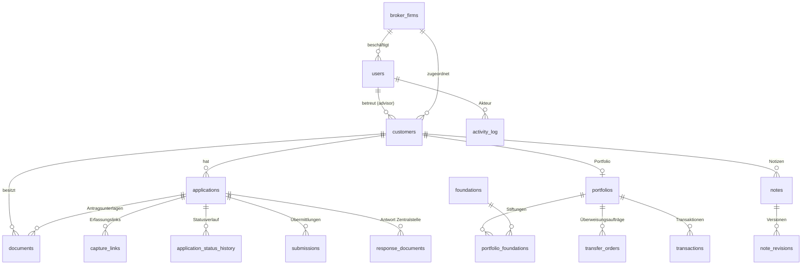
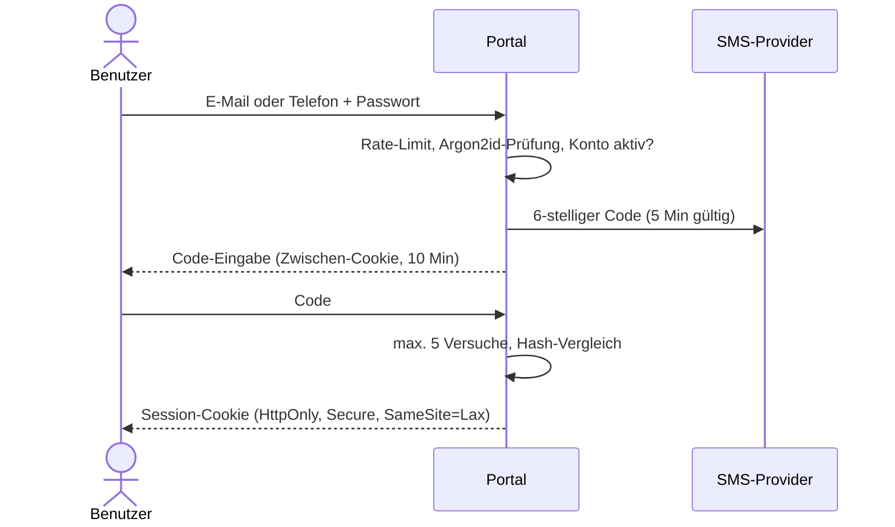
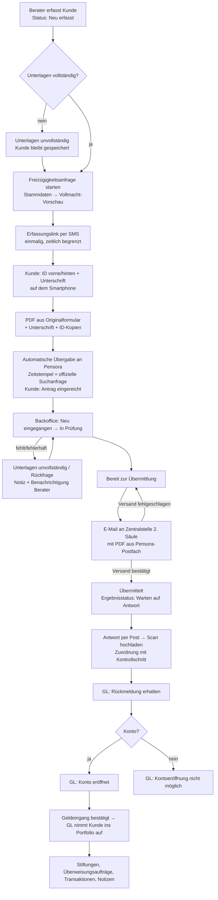

# Pensora-Portal – Phase 1: Architektur- und Fachkonzept

Stand: 26.11.2026 · Status: Entwurf zur Freigabe durch Pensora GL

Dieses Dokument legt die technische Architektur, das Datenmodell, die Rollen- und Berechtigungsmatrix, die Navigation, die Kernprozesse und das Schnittstellenkonzept fest. Alles, was der Masterprompt nicht eindeutig regelt, ist in Kapitel 10 als **offene Frage** aufgeführt. Wo für die Implementierung ein vorläufiger Standard nötig war, ist er dort als **Annahme (A)** markiert und über Konfiguration änderbar.

---

## 1. Architekturentscheid

| Bereich | Entscheid | Begründung |
|---|---|---|
| Frontend + Backend | **Next.js 16 (App Router) mit TypeScript**, Server Components, Server Actions und Route Handlers | Ein Codebase, serverseitiges Rendering, keine Geschäftslogik im Browser |
| Datenbank | **PostgreSQL 16** (lokal, Supabase oder Schweizer Managed-Postgres) | Relational, Transaktionen, Constraints für Datenintegrität |
| Datenzugriff | **Drizzle ORM** mit versionierten SQL-Migrationen | Typsicher, ausschliesslich parametrisierte Queries (SQL-Injection-Schutz) |
| Validierung | **zod**-Schemas auf dem Server für jede Eingabe | Manipulierte Formulare werden serverseitig abgewiesen |
| Authentifizierung | Eigene Implementierung: Argon2id-Passworthashes, serverseitige Sessions in der DB, SMS-Einmalcode als 2. Faktor | Login mit E-Mail **oder** Telefonnummer + SMS-2FA ist mit Standard-Auth-Diensten nur umständlich abbildbar; volle Kontrolle über Sperren, Timeouts und Protokollierung |
| Autorisierung | Zentrale **Policy-Schicht** (`src/server/authz`): Rolle → Berechtigungen (in DB konfigurierbar) + **Datenbereich** (Scope) pro Benutzer, die in jede Query eingebaut wird | Rechteprüfung serverseitig, nie nur über ausgeblendete Menüs |
| Dokumente | Speicher-Schnittstelle mit **AES-256-GCM-Verschlüsselung in der Anwendung** (vor dem Speichern), Auslieferung nur über geprüfte Download-Routen | Kein öffentlicher Dokumentlink, verschlüsselt unabhängig vom Anbieter |
| PDF | **pdf-lib** befüllt das **Original-Vollmachtformular** (Overlay an vermessenen Positionen), hängt Unterschrift und ID-Kopien an | Das Original wird verwendet, kein Nachbau |
| SMS / E-Mail / Speicher | Austauschbare **Provider-Schnittstellen**, Aktivierung über Umgebungsvariablen; ohne Zugangsdaten sichtbar als „nicht aktiv“ markiert | Anbieterwechsel ohne Codeänderung in der Fachlogik |
| Styling | Tailwind CSS 4, eigene UI-Komponenten im Pensora-Design | Weiss, dunkle Schrift, Violett als Akzent |
| Tests | Vitest (Unit + Integration gegen Test-DB), Rollen- und Zugriffstests in Phase 8 | |

### Schichten

```
Browser (React UI, nur Darstellung)
   │  HTTPS, HttpOnly-Session-Cookie
   ▼
Next.js Server
   ├─ app/(portal)/…       Seiten (Server Components) – rufen nur Services auf
   ├─ app/…/actions.ts     Server Actions – Validierung (zod) → Service
   ├─ app/api/…            Route Handlers – Datei-Up/Download, Export, Erfassungslink
   ├─ server/auth          Login, 2FA, Sessions, Passwort-Reset
   ├─ server/authz         Rollen, Berechtigungen, Datenbereiche (Scopes)
   ├─ server/services      Fachlogik (Kunden, Anträge, Backoffice, Portfolio …)
   ├─ server/integrations  SMS-, E-Mail-, Speicher-Provider
   ├─ server/pdf           Befüllung des Original-Vollmachtformulars
   └─ server/db            Drizzle-Schema, Migrationen
   ▼
PostgreSQL            Verschlüsselter Dokumentspeicher (lokal / S3-kompatibel)
```

Regel: **Seiten und Actions greifen nie direkt auf die Datenbank zu**, sondern immer über einen Service, der den angemeldeten Benutzer (`actor`) erhält und Berechtigung + Datenbereich prüft.

---

## 2. Datenmodell

Alle Primärschlüssel sind zufällige UUIDs (nicht erratbar). Zeitstempel als `timestamptz` (UTC gespeichert, Anzeige Europe/Zurich). Beträge als `numeric(14,2)` in CHF.



### Tabellen (Kurzfassung)

**Benutzer und Rechte**
- `broker_firms` – Name, Adresse, Kontakt, aktiv/inaktiv.
- `users` – Vorname, Nachname, E-Mail (eindeutig), Telefon E.164 (eindeutig), `role`, `broker_firm_id` (nur Broker-Rollen), Passwort-Hash (Argon2id), Status (aktiv/deaktiviert), fehlgeschlagene Logins, Sperrzeit, `deleted_at`.
- `role_permissions` – (Rolle, Berechtigung, erlaubt). Standardwerte siehe Kapitel 3; Pensora GL kann sie unter *Einstellungen → Rollen & Berechtigungen* ändern (z.B. Statusänderung für Backoffice/Closer später freischalten).
- `sessions` – Hash des Session-Tokens, Benutzer, Ablauf (Leerlauf + absolut), IP, User-Agent.
- `otp_challenges` – SMS-Code-Hash, Zweck (Login, Telefonbestätigung), Versuche, Ablauf.
- `password_reset_tokens` – Token-Hash, Ablauf, verwendet am.

**Kunden und Anträge**
- `customers` – Stammdaten (Vorname, Nachname, Geburtsdatum, AHV-Nr. **eindeutig**, Strasse/Nr., PLZ, Ort, Telefon, E-Mail), `advisor_id`, `broker_firm_id` (automatisch vom Berater übernommen, bei Pensora-Beratern leer = „Pensora intern“), `intake_status` (Neu erfasst / Unterlagen unvollständig / Bereit zur Antragstellung / Antrag eingereicht – wird automatisch aus Dokumenten und Anträgen abgeleitet), `created_at`, `created_by`, `deleted_at`.
- `applications` (Freizügigkeitsanfrage) – Kunde, Berater und Brokerfirma *zum Zeitpunkt der Antragstellung* (Snapshot für Auswertungen), `created_at` (Antragsdatum), `submitted_to_pensora_at` (**offizieller Zeitpunkt der Suchanfrage**), `review_status` (Backoffice), `outcome_status` (nach Übermittlung), `transmitted_at`, `generated_pdf_document_id`, Snapshot der ins Formular übernommenen Stammdaten.
- `documents` – Typ (Vollmacht-PDF, ID Vorderseite, ID Rückseite, Unterschrift, Antwortdokument, Sonstiges), Kunde, Antrag (optional), Speicherschlüssel, MIME-Typ, Grösse, SHA-256, hochgeladen von (Benutzer oder Erfassungslink), Eingangsdatum.
- `capture_links` – Token-Hash, Antrag, Ablauf, max. Verwendungen, Verwendungen, Status, gesendet an (Telefon), widerrufen am.
- `application_status_history` – Art (review/outcome), alter Status, neuer Status, Benutzer, Zeitpunkt, Bemerkung.
- `submissions` – Übermittlung an die Zentralstelle: Empfänger, Betreff, Text, Anhang (Dokument), Provider, Provider-Message-ID, Status (`pending`/`sent`/`failed`), Fehlertext, `sent_at`, ausgelöst von.
- `response_documents` – Antwortdokument der Zentralstelle: Antrag, Dokument, Eingangsdatum, erfasst von, bestätigte Zuordnung (Kunde + AHV-Kontrolle).

**Portfolio**
- `foundations` – Stammliste der Stiftungen (Name, Adresse).
- `portfolios` – genau ein Portfolio pro Kunde (`customer_id` eindeutig), aufgenommen am/durch, entfernt am.
- `portfolio_foundations` – Stiftungen eines Kunden (mehrere möglich, einzeln verwaltbar), Konto eröffnet am, Bemerkung.
- `transfer_orders` – Überweisungsaufträge: Stiftung, Auftragsdatum, Auftragsstatus, Auftragsbetrag, Eingangsdatum, tatsächlich eingegangener Betrag.
- `transactions` – Stiftung, Betrag, Auftragsdatum, Eingangsdatum, interne Bemerkung, Art (`eingang` / `korrektur`), optional Bezug zu Überweisungsauftrag. **Der eingegangene Gesamtbetrag wird immer aus den Transaktionen berechnet**; manuelle Korrekturen sind eigene Korrektur-Transaktionen mit Pflichtbegründung.

**Notizen, Historie, Benachrichtigungen**
- `notes` / `note_revisions` – interne Kundennotizen; Bearbeiten erzeugt eine neue Version, die alte bleibt sichtbar („bearbeitet“).
- `activity_log` – unveränderliches Protokoll aller kritischen Aktionen (Akteur, Aktion, Objekt, Kunde, Vorher/Nachher-Werte, IP, Zeitpunkt). Die Kundenhistorie ist eine gefilterte Sicht darauf.
- `notifications` – In-App-Benachrichtigungen (z.B. „Erfassung abgeschlossen“, „Neuer Antrag eingegangen“).
- `settings` – Systemeinstellungen (Empfänger/Betreff Zentralstelle, Linkgültigkeit, Formularvorlage).

### Integritätsregeln
- **Ein Kunde existiert nur einmal**: eindeutiger Index auf der normalisierten AHV-Nummer, zusätzlich Dublettenwarnung bei gleichem Namen + Geburtsdatum.
- Anträge, Dokumente, Portfolio und Notizen verweisen per Fremdschlüssel auf denselben Kundendatensatz; Löschen eines Kunden mit Verknüpfungen ist technisch gesperrt (nur Soft-Delete/Anonymisierung nach Aufbewahrungsfrist).
- Brokerfirma eines Kunden wird aus dem Berater abgeleitet; ein Berater einer Brokerfirma kann keinen Kunden einer anderen Firma besitzen (Prüfung im Service).

---

## 3. Rollen- und Berechtigungsmatrix

Rollen: **GL** = Pensora GL, **BO** = Pensora Backoffice, **CL** = Pensora Closer (vorbereitet, deaktiviert), **BGL** = Externe Broker GL, **BB** = Externe Broker Berater, **PB** = Pensora Berater.

### 3.1 Datenbereich (welche Kunden sieht ein Benutzer?)

| Rolle | Kunden-Datenbereich |
|---|---|
| GL | alle Kunden |
| BO | Kunden mit mindestens einem an Pensora übermittelten Antrag (für die Bearbeitung erforderlich) |
| CL | keiner (bis Freischaltung) |
| BGL | alle Kunden der eigenen Brokerfirma |
| BB, PB | nur eigene Kunden (`advisor_id = eigener Benutzer`) |

Der Datenbereich wird **in jede Datenbankabfrage** eingebaut. Ein Aufruf einer fremden Kunden-ID liefert „nicht gefunden“ (404), damit nicht einmal die Existenz verraten wird.

### 3.2 Funktionsrechte (Standard)

| Berechtigung | GL | BO | CL | BGL | BB | PB |
|---|:-:|:-:|:-:|:-:|:-:|:-:|
| Dashboard ansehen | ✓ | ✓ | – | ✓ | ✓ | ✓ |
| Kunden ansehen (im Datenbereich) | ✓ | ✓ | – | ✓ | ✓ | ✓ |
| Kunden erfassen | ✓ | – | – | – (A) | ✓ | ✓ |
| Kundendaten bearbeiten | ✓ | – | – | – | ✓ (A) | ✓ (A) |
| Kunde einem anderen Berater zuweisen | ✓ | – | – | – | – | – |
| Freizügigkeitsanfrage auslösen / Erfassungslink senden | ✓ | – | – | – | ✓ | ✓ |
| Anträge ansehen (im Datenbereich) | ✓ | ✓ | – | ✓ | ✓ | ✓ |
| Überprüfungen & Übermittlungen | ✓ | ✓ | – | – | – | – |
| Prüfstatus ändern, Übermittlung an Zentralstelle | ✓ | ✓ | – | – | – | – |
| Antwortdokumente hochladen | ✓ | ✓ | – | – | – | – |
| Antragsstatus (Ergebnis) ändern | ✓ | ☐ | ☐ | – | – | – |
| Portfolio ansehen (im Datenbereich) | ✓ | ☐ | – | ✓ | ✓ | ✓ |
| Portfolio bearbeiten (aufnehmen, Stiftungen, Aufträge, Transaktionen) | ✓ | ☐ | – | – | – | – |
| Interne Notizen erfassen | ✓ | ✓ | – | – (A) | ✓ (A) | ✓ (A) |
| Benutzer verwalten | ✓ | – | – | – | – | – |
| Eigene Mitarbeiter ansehen | ✓ | – | – | ✓ | – | – |
| Brokerfirmen verwalten | ✓ | – | – | – | – | – |
| Export CSV/Excel | ✓ | – (A) | – | – (A) | – | – |
| Einstellungen / Integrationen / Rollenrechte | ✓ | – | – | – | – | – |
| Protokoll (Audit-Log) einsehen | ✓ | – | – | – | – | – |

✓ = Standard erlaubt · – = nicht erlaubt · ☐ = vorbereitet, durch GL freischaltbar · (A) = Annahme, siehe offene Fragen

---

## 4. Navigation und Seitenstruktur

Seitliche Navigation (rollenabhängig ein-/ausgeblendet, Zugriff zusätzlich serverseitig gesperrt):

| Menüpunkt | Route | Rollen |
|---|---|---|
| Dashboard | `/dashboard` | GL, BO, BGL, BB, PB |
| Kunden | `/kunden`, `/kunden/neu`, `/kunden/[id]` (Tabs: Übersicht, Dokumente, Anträge, Portfolio, Historie & Notizen) | GL, BO, BGL, BB, PB |
| Anträge | `/antraege`, `/antraege/[id]` | GL, BO, BGL, BB, PB |
| Überprüfungen & Übermittlungen | `/pruefung` (Eingang), `/pruefung/[id]`, `/pruefung/uebermittlungen`, `/pruefung/antwortdokumente` | GL, BO |
| Portfolio | `/portfolio`, `/portfolio/[customerId]` (Tabs: Kunde, Stiftungen & Überweisungsaufträge, Transaktionen, Historie & Notizen) | GL, BGL, BB, PB |
| Mitarbeiterverwaltung | `/mitarbeiter` (Benutzer), `/mitarbeiter/broker` (Brokerfirmen) | GL, BGL (nur lesen, eigene Firma) |
| Einstellungen | `/einstellungen` (Profil, Passwort), GL zusätzlich: Rollenrechte, Integrationen, Zentralstelle, Formularvorlage, Stiftungen, Protokoll | alle |

Öffentliche Seiten: `/login`, `/login/code` (SMS-Code), `/passwort-vergessen`, `/passwort-zuruecksetzen/[token]`, `/erfassung/[token]` (mobile Kundenerfassung von ID und Unterschrift).

Kopfzeile: globale Suche (Kunden und Anträge im eigenen Datenbereich), Benachrichtigungen, Benutzermenü.

---

## 5. Kernprozesse

### 5.1 Login mit SMS-2FA


Session: 30 Min Leerlauf-Timeout, max. 12 Std. absolut (A). Nach 5 Fehlversuchen wird das Konto 15 Min gesperrt (A).

### 5.2 Vom Kunden bis zum Portfolio



### 5.3 Erfassungslink (Sicherheit)
- 256-Bit-Zufallstoken, in der DB nur als SHA-256-Hash gespeichert.
- Gültigkeit 72 Std. (A), standardmässig **einmalig**; der Berater kann einen Link widerrufen und einen neuen senden.
- Die Erfassungsseite zeigt nur Vorname und Initiale des Nachnamens zur Bestätigung und gibt keine weiteren Kundendaten preis; Uploads werden ausschliesslich dem Antrag des Links zugeordnet.
- Bilder: JPEG/PNG/HEIC→ werden serverseitig geprüft (Magic Bytes), max. 10 MB je Datei.

### 5.4 Übermittlung an die Zentralstelle
Status `sent` wird nur gesetzt, wenn der E-Mail-Provider die Annahme bestätigt (SMTP 250 bzw. API-Erfolg). Bei Fehler: Status `failed` mit Fehlermeldung, der Antrag bleibt auf „Bereit zur Übermittlung“. Ohne konfigurierten E-Mail-Provider ist der Versand-Button deaktiviert und als „E-Mail-Integration nicht aktiv“ gekennzeichnet; PDF-Download bleibt möglich.

### 5.5 Antwortdokument zuordnen
Backoffice wählt den Antrag (Suche nach Name/AHV), lädt das PDF hoch, erfasst das Eingangsdatum und muss im Bestätigungsschritt **Name, Geburtsdatum und die letzten 4 Ziffern der AHV-Nr.** des Zielkunden sehen und die Zuordnung ausdrücklich bestätigen.

---

## 6. Schnittstellenkonzept

Alle externen Dienste stehen hinter Interfaces in `src/server/integrations`. Der aktive Provider wird über Umgebungsvariablen gewählt; die Einstellungsseite zeigt pro Integration **Aktiv / Nicht aktiv / Entwicklungsmodus**.

| Schnittstelle | Interface | Implementierungen | Ohne Zugangsdaten |
|---|---|---|---|
| SMS | `SmsProvider.send(to, text)` | Twilio (REST), ASPSMS (Schweiz, REST), `dev-log` (nur Entwicklung: Code im Server-Log) | Produktion: Login-2FA und Linkversand nicht möglich, klare Fehlermeldung |
| E-Mail | `EmailProvider.send({to, subject, text, attachments})` | SMTP (z.B. Microsoft 365, Infomaniak, Hostpoint) | Versand deaktiviert, sichtbar gekennzeichnet |
| Dokumentspeicher | `StorageProvider.put/get/delete` | Lokales Dateisystem (verschlüsselt), S3-kompatibel (Supabase Storage, Exoscale, Infomaniak) | Lokal verschlüsselt (Entwicklung) |
| PDF-Vorlage | `templates/vollmacht.pdf` + Feldkoordinaten in `src/server/pdf/vollmacht-layout.ts` | – | – |

Der `dev-log`-SMS-Provider ist im Produktionsmodus gesperrt; die Anwendung startet dort nicht damit.

---

## 7. Sicherheit und Datenschutz (revDSG)

- TLS überall (Hosting), HSTS, Content-Security-Policy, `X-Frame-Options: DENY`.
- Passwörter: Argon2id; Mindestlänge 12 Zeichen; Reset-Token einmalig, 30 Min gültig, nur als Hash gespeichert.
- Sessions serverseitig, widerrufbar (Deaktivieren eines Benutzers beendet alle Sessions sofort).
- Rechteprüfung in jedem Service, Datenbereich in jeder Query, UUIDs statt fortlaufender IDs, 404 bei fremden Objekten.
- Server Actions mit Origin-Prüfung (Next.js), zod-Validierung jeder Eingabe; React escaped Ausgaben (XSS), kein `dangerouslySetInnerHTML`.
- Uploads: Whitelist (PDF, JPEG, PNG, WebP, HEIC), Prüfung der Magic Bytes, Grössenlimit, zufälliger Speichername, AES-256-GCM-verschlüsselt gespeichert, Download nur über autorisierte Route mit `Content-Disposition`.
- AHV-Nummern werden in Tabellen maskiert angezeigt (756.••••.••••.12), vollständig nur in Kundenakte/Prüfung.
- Audit-Log für Login, Datenänderungen, Statuswechsel, Dokumentzugriffe, Exporte, Übermittlungen.
- Backups: tägliche DB-Backups mit Point-in-Time-Recovery beim Hosting-Anbieter, verschlüsselter Dokumentspeicher mit Versionierung; Wiederherstellungstest quartalsweise.
- Datenhaltung in der Schweiz empfohlen (Hosting-Frage siehe 10).
- **Aufbewahrung und Löschung (Vorschlag, juristisch zu bestätigen):** Geschäftsunterlagen 10 Jahre nach Abschluss der Geschäftsbeziehung (Art. 958f OR). Kunden ohne eingereichten Antrag: Löschung/Anonymisierung nach 24 Monaten Inaktivität. Benutzer mit verknüpften Daten werden deaktiviert statt gelöscht. Löschungen erfolgen als Anonymisierung mit Protokolleintrag; ID-Kopien und Unterschriften werden nach Ablauf physisch gelöscht.

---

## 8. Umsetzungsplan

| Phase | Inhalt | Ergebnis |
|---|---|---|
| 1 | Dieses Konzept, Projektgerüst, DB-Schema + Migrationen, Berechtigungssystem, Layout | lauffähiges Grundgerüst |
| 2 | Login, SMS-2FA, Passwort-Reset, Benutzer- und Brokerverwaltung | |
| 3 | Kunden erfassen/bearbeiten, Übersicht, Suche, Filter, Kundenakte | |
| 4 | Antrag, Vollmacht-Vorschau, PDF aus Original, Erfassungslink, ID-Upload, Unterschrift | |
| 5 | Prüfung, Übermittlung per E-Mail, Übermittlungsübersicht | |
| 6 | Antwortdokumente, Ergebnisstatus, Historie | |
| 7 | Portfolio, Stiftungen, Aufträge, Transaktionen, Notizen | |
| 8 | Rollen-/Zugriffstests, Mobile, Sicherheitsprüfung | |

---

## 9. Bewusst nicht übernommen
Die Referenz-Screenshots eines Drittanbieters dienten nur als Strukturbeispiel (Seitenleiste, Tabellen, Kundenakte mit Tabs). Branding, Logo, Farben und alle darin sichtbaren Personendaten werden nicht verwendet.

---

## 10. Offene Fragen an Pensora

**Betrieb und Anbieter**
1. **Hosting**: Wo soll das Portal laufen? Empfehlung: Datenhaltung in der Schweiz (z.B. Supabase Region Zürich für Postgres + Speicher, oder Infomaniak/Exoscale).
2. **SMS-Anbieter**: Twilio, ASPSMS oder anderer? Absenderkennung (z.B. „Pensora“)?
3. **E-Mail**: Welches Geschäftspostfach (Microsoft 365, Infomaniak …)? SMTP-Zugang oder App-Passwort?
4. **Zentralstelle 2. Säule**: Exakte Empfängeradresse, gewünschter Betreff und Begleittext? Ein PDF pro Antrag oder Sammelversand?
5. **Domain** für Portal und Erfassungslink (z.B. portal.pensora.ch)?

**Fachliche Regeln**
6. **Dubletten**: Was passiert, wenn ein Berater einen Kunden erfasst, der (per AHV) bereits bei einem anderen Berater/Broker existiert? (A: Erfassung wird abgelehnt mit Hinweis „Kunde bereits erfasst, bitte Pensora kontaktieren“, ohne den anderen Berater offenzulegen.)
7. Darf **Broker GL** selbst Kunden erfassen oder Kunden seiner Berater bearbeiten/umverteilen? (A: nur lesen.)
8. Dürfen **Berater** Stammdaten nach Antragseinreichung noch ändern? (A: bis zur Übergabe an Pensora ja, danach nur GL.)
9. **Rückfrage/Unterlagen unvollständig** im Backoffice: Soll der Berater automatisch benachrichtigt werden und kann er Unterlagen nachreichen (neuer Erfassungslink), wonach der Antrag wieder auf „Neu eingegangen“ geht? (A: ja, Benachrichtigung + Nachreichen; Status setzt das Backoffice zurück.)
10. Mehrere **Anträge pro Kunde** erlaubt (z.B. neue Suchanfrage nach Jahren)? (A: ja, aber nur ein offener Antrag gleichzeitig.)
11. **Erfassungslink**: Gültigkeitsdauer (A: 72 Std.) und einmalig oder mehrfach verwendbar (A: einmalig)?
12. Soll der Berater die Unterschrift auch **vor Ort** im Portal (Tablet) erfassen können, ohne SMS-Link?
13. „Ort“ auf der Vollmacht: Wohnort des Kunden (laut Vorgabe) – korrekt, auch wenn vor Ort beim Berater unterschrieben wird?
14. **Auftragsstatus** der Überweisungsaufträge: Welche Werte? (A: Erteilt, In Bearbeitung, Ausgeführt, Storniert.)
15. Sind **Transaktionen** immer einem Überweisungsauftrag zugeordnet, oder können sie frei erfasst werden? (A: optionaler Bezug.)
16. **Notizen**: Dürfen Berater und Broker GL Notizen in ihren Kundenakten erfassen und die Notizen von Pensora sehen? (A: Berater ja, Broker GL nur lesen; interne Pensora-Notizen können als „nur intern“ markiert werden.)
17. **Export**: Welche Rollen dürfen exportieren? (A: nur GL.)
18. **Aufbewahrungsfristen** und Löschkonzept juristisch bestätigen (siehe Kapitel 7).
19. **Sprache**: Nur Deutsch, oder auch Französisch/Italienisch (Portal und Erfassungsseite)?
20. **Logo**: Bitte Pensora-Logo als SVG/PNG und exakte Violett-Farbwerte liefern (vorläufig aus dem Vollmachtformular übernommen: #5B168A).
